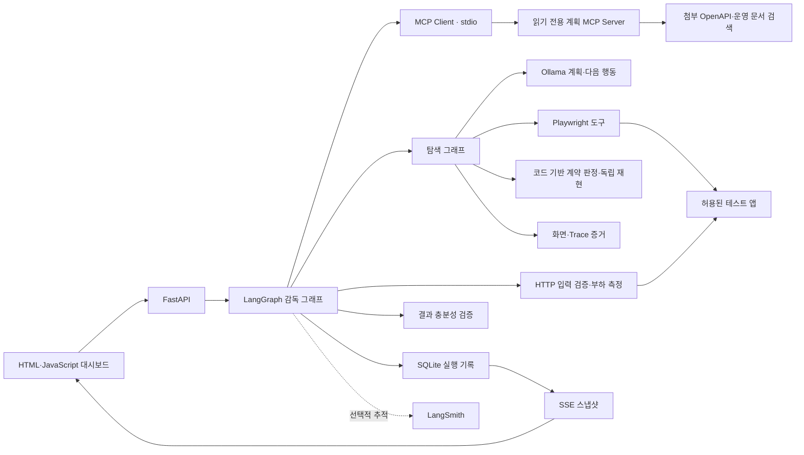

# CrashCustomer 기술 구조

## 목적과 검증 범위

개발자가 로컬·허용된 테스트 서버에서 목표 작업을 수행하게 하고, 관찰한 요청에 장애를 주입해 사용자 경험의 실패를 찾는 AI QA 도구다. 외부 배포 없이 실행한다. 업로드한 프로젝트를 자동 빌드하는 서비스나, 실제 운영 장애의 근본 원인을 항상 확정하는 도구는 아니다.

## 구성과 데이터 흐름

별도 `mcp_server.py`는 외부 MCP 클라이언트가 CrashCustomer의 HTTP API를 호출하는 방향이다. 그래프가 조회하는 `mcp_context_server.py`와 역할을 구분한다. MCP 서버가 다시 캠페인을 시작하는 재귀 호출은 하지 않는다.

## 감독 그래프

`route → recon → gate → retrieve → plan → replan_check → attack → probe → write → validate → finalize`

- 일반 안내는 `chat_answer → finalize`로 분기하며 테스트를 실행하지 않는다.
- `gate`는 기준선의 목표 완료를 요구한다. 미완료면 장애 주입·부하를 생략하고 판정 불가로 종료한다.
- `retrieve`는 실제 MCP Prompt·Resource·검색 Tool을 조회한다. 첨부 자료는 명령이 아닌 참고 데이터다.
- `plan`은 관찰된 요청에서 생성한 후보 ID만 선택한다. 모델이 임의 엔드포인트나 코드를 생성·실행할 수 없다.
- `replan_check`는 적용 가능한 장애 유형 중 예산 내 누락을 검사한다. 제한 재계획 후에도 누락되면 출처를 표시하고 규칙으로 보완한다.
- `attack`은 브라우저 실행을 순차 조율한다. 하위 탐색 그래프는 `observe → assess → decide → act`를 반복한다.
- `validate`는 기준선·주입 적용·재현 근거·측정 유효성·점검 범위·요약 수치 일치를 검사한다.

계획 LLM과 탐색 LLM은 역할·입출력을 분리한다. 검증은 다른 LLM의 의견 대신 계약 코드와 관찰 재현을 사용한다. 병렬로 토론하는 독립 LLM Worker 구조는 아니다.

## 의존성 주입과 테스트

`CampaignManager`는 저장소 공급 함수, 세마포어, 계획기 팩토리, 실행기, HTTP 측정 클라이언트, MCP 컨텍스트 팩토리를 주입받는다. 실제 모델·브라우저·HTTP 전송을 테스트 대역으로 바꿔 실패·인증·취소·누락·판정 경계를 검증한다. 별도 실제 모델·브라우저 측정은 테스트 대역의 결과와 구분해 JSON에 보존한다.

## 상태와 스트리밍

실행 결과는 SQLite, 파일 사본과 화면·Trace는 `data`에 저장한다. SSE 이벤트 ID는 저장 스냅샷의 해시다. Last-Event-ID를 이용해 동일 스냅샷 중복을 피하고, 끊기면 최신 상태를 다시 읽는다. 모든 중간 이벤트의 영구 큐 전달을 보장하는 방식은 아니다. 하위 탐색 진행도 캠페인의 SSE에 포함된다. 모델의 JSON 토큰 자체를 스트리밍하지는 않는다.

실행 Task·실험실 자원은 프로세스 메모리에 있으므로 재시작 후 이어 실행하는 stateless/distributed Worker 구조는 아니다. 중단 기록은 남기며 다시 실행해야 한다.

## 인증·실행 통제

- 로컬·명시적 허용 테스트 호스트만 사용하고 같은 출처 밖의 브라우저 요청을 차단한다.
- 이번 실행의 Bearer 토큰은 메모리에서만 사용한다. 인증 사용 실행은 Trace를 저장하지 않는다. 관찰에는 알려진 인증값을 마스킹한다.
- API 부하는 2xx와 관찰된 JSON 응답 형식을 먼저 확인한다. 인증 실패·로그인 HTML을 성능 정상으로 계산하지 않는다.
- 브라우저 재현은 새 컨텍스트를 쓰지만 등록 앱의 서버 데이터는 초기화하지 않는다. 테스트 계정·합성 데이터가 전제다.
- LangSmith 추적은 설정해야 활성화된다. 활성화하면 합성·테스트 관찰과 검색 근거가 외부로 전송된다. 실제 수신 검증 여부는 별도 증거로 기록한다.

## 증거와 재현

실행 ID, 설정, 행동 순서, 요청 상태, 전후 화면, 재현 결과, API 측정, 모델 토큰·시간을 연결한다. 중복 2xx는 실제 주문 두 건 생성과 구분한다. 부하 측정은 단일 머신의 GET 요청이고, 내부 실험실은 Python·SQLite 구조 모델이다. 이를 실제 Hangari의 Spring/Hikari 성능이나 과거 베타 운영 사실의 증명으로 사용하지 않는다.
