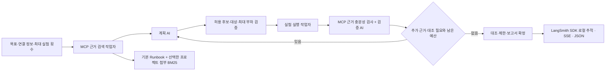
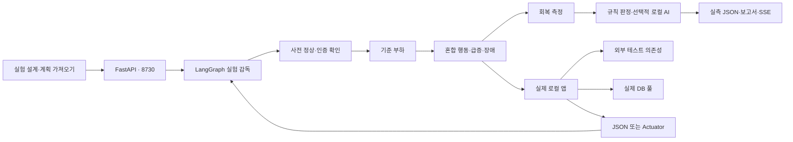

# BurstGuard 구조

2026-10-22 갱신: 아래의 부하 실행기 위에 새 메인 AI 감독 그래프가 통합되어 있습니다.



`agents.py`는 계획·검증 모델, MCP context factory를 주입받습니다. 실제 stdio MCP가 계획 Prompt, Runbook Resource, 첨부 검색 Tool, 실측 검증 Tool을 제공합니다. 계획 AI와 검증 AI는 역할별로 별도 호출되며 수치·판정은 코드 검증을 통과해야 합니다. 실행 작업자의 기존 LangGraph는 다음과 같습니다.

```text
부하: preflight → baseline → fault → recovery → integrity
정합성 전용: preflight → integrity
```

관찰 후 규칙 판정과 근거 충분성 검증을 구분합니다. 문제를 찾은 실험도 근거가 충분할 수 있고, HTTP 200만 얻어도 상태·지표·표본이 부족하면 근거는 partial입니다. 감독의 complete는 서비스 무결함 보장이 아닙니다.



- `burstguard/models.py`: 대상·경로 경계, 단계별 시간, 행동·응답 조건, 런타임 인증 설정.
- `burstguard/engine.py`: LangGraph 단계 감독, 사용자별 HTTP 클라이언트, 가중치 행동, 최대 200명, 단계당 50,000요청 예산, 중단·제어 복원.
- `burstguard/metrics.py`: 실제 앱 계측을 읽고 미연결 지표는 미확인으로 유지.
- `burstguard/analysis.py`: 관측 근거로 문제를 판정하고 원인을 단정하지 않음. AI는 익명 집계 결과와 유효한 후속 실험 후보만 로컬 Ollama에 전달. JSON 스키마·후보 ID를 검증해 우선순위만 수용하며, 실행 판정과 수치를 덮어쓰지 않음.
- `burstguard/storage.py`: 원자적 파일 교체로 실험별 JSON 저장, 서버 재시작 시 미완료 실험 표시.
- `burstguard/agents.py`: 메인 감독 그래프, 계획·검증 AI, 읽기 전용 MCP 클라이언트, 최대 3회 실행 예산, 자식 실행의 부모 SSE 통합, LangSmith RunTree 로컬 추적.
- `burstguard/mcp_server.py`, `runbooks.md`: 실제 stdio MCP Prompt·Resource·검색·검증 도구. 프로젝트 자료는 참고 근거로만 사용.
- `burstguard/validation.py`: 실측 표본·계측·정합성·복원 충분성 검사, 원래 실험과 대조 실험의 관측 비교.
- `examples/resilience_app.py`: 실제 HTTP 외부 호출과 실제 SQLite 연결 풀을 쓰는 변경 전후 재현 앱. Spring/HikariCP 구현은 아님.
- `web/`: 새 메인 화면. 가짜 그래프/기본 숫자 대신 실측 표본을 사용.
- `crashcustomer/`, `static/`: 원본에서 복사한 브라우저 검사, 재현, RAG/MCP 기능. `/browser`에서 접근.

## 실험 의미

실험은 기준 단계 → 트래픽·장애 단계 → 회복 단계입니다. spike/ramp는 기준·회복 2명, 부하 단계 최대 인원을 사용하고 steady는 모든 단계에 같은 인원을 사용합니다. 보호 기능이 설정되면 전체 인원 중 1명을 독립 요청에 예약합니다. 나머지 사용자는 가중치로 행동을 고르고 steps를 순서대로 수행합니다. 가중치는 행동 시작 확률이며, 느린 로그인과 빠른 조회의 완료 요청 비율은 다를 수 있습니다.

각 단계는 새 가상 사용자 세션으로 시작합니다. 단계 내에는 사용자별 쿠키·추출 값이 유지되지만 단계 사이 로그인 세션은 이어지지 않습니다. 로그인 후 API를 호출하려면 같은 행동의 steps에 작성해야 합니다.

요청이 부하 단계 종료 시 진행 중이면 타임아웃 또는 완료까지 기다립니다. 따라서 실제 단계 시간은 설정한 트래픽 투입 시간보다 길 수 있습니다. 중단 시 클라이언트 요청을 취소하고 장애 설정을 복원하지만 이미 서버에 도착한 요청을 강제로 종료하지는 않습니다. 회복 단계에서 잔여 영향도 관측합니다.

## 판정 기준

- 실패 응답·전송 오류·타임아웃·응답 조건 불일치를 요청 실패로 집계.
- 전체 오류율 1% 초과 또는 P95 목표 초과를 문제로 표시.
- 보호 기능의 기준·부하 표본이 각각 3건 이상이고 기준 오류율 1% 이하일 때만 영향 여부를 비교.
- 보호 기능 오류율 1% 초과 또는 P95가 목표를 초과하면서 기준 대비 2배 초과이면 영향 관측.
- 실제 pool_active가 pool_max에 도달하고 pool_pending이 양수이면 풀 포화·대기 관측.
- 지표 누락·표본 부족·복원 실패는 제한으로 보고. 모든 경우에 내부 원인이나 운영 안정성을 보장하지 않음.

비교는 동일 설정의 두 대상을 순차 실행합니다. 같은 머신의 시간 흐름·온도·캐시·테스트 데이터 변화는 통제하지 못하며, 엄밀한 벤치마크에는 반복 측정과 독립 부하 생성기가 추가로 필요합니다.

## 감독의 실행·보안 경계

AI는 사용자가 연결한 대상·요청 본문·인증·API 경로를 만들거나 바꾸지 않습니다. 허용 후보는 원래 조건, 더 낮은 부하, 장애 해제 대조, 독립 데이터 반복입니다. 최대 1~3회 안에 원래 조건을 반드시 계획하며, 사전 인증 실패는 자동 부하 반복으로 우회하지 않습니다. 측정을 마치지 못하면 원래 조건을 검사했다고 표시하지 않습니다.

작업자는 사용자별 HTTP 세션과 기존 취소·장애 복원을 사용합니다. 자식 기록은 부모 실험 안에 저장해 AI 계획 대기 중에도 SSE 연결이 종료되지 않습니다. Bearer 토큰은 런타임에만 전달하고 저장·검색·모델·추적 입력에 포함하지 않습니다.

LangSmith SDK의 실제 RunTree로 부모/자식 실행을 구성하고 완료·실패·역할·경과 시간을 기본적으로 로컬 JSON에 기록합니다. 감독 자체는 `.post()`를 호출하지 않습니다. 별도 `verify_resilience_cloud.py`에서 명시적으로 선택한 합성 실행의 허용 메타데이터만 클라우드로 전송·재조회합니다. 2026-10-22 실제 13/13개 수신을 확인했으며, 해당 실행의 화면·보고서에만 수신 증거를 표시합니다. 프롬프트 전체의 실시간 전송과 구분합니다. 실행 Task는 여전히 단일 서버 메모리에 있으므로 stateless/distributed worker라고 설명하면 안 됩니다.
