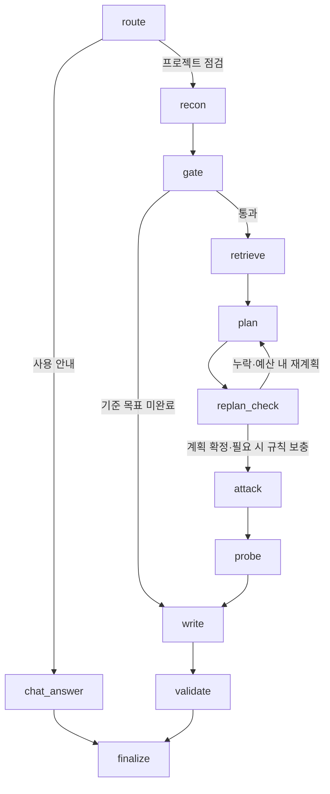

# 우선순위 1~4 구현 및 검증

2026-10-21 (Asia/Seoul). 기존 점검 기능에 검증·스트리밍·재계획·MCP 실제 조회를 추가했다. 원본 Hangari 소스는 수정하지 않았다.

## 구현

1. 기준선·인증·결과 검증
   - 장애 없는 목표 완료가 확인된 실행만 장애 점검으로 진행한다. 예산 초과·판정 불가는 gate에서 종료한다.
   - 이번 실행용 Bearer 토큰을 같은 출처 브라우저와 API 측정에 전달한다. DB·보고서에 저장하지 않고 실행 종료 시 메모리 매핑을 제거한다.
   - 인증 사용 실행은 Playwright Trace를 저장하지 않는다. 알려진 토큰과 비밀번호 필드를 관찰·캡처에서 마스킹한다. 합성 테스트 데이터 사용이 전제이며 임의 비밀값 전체에 대한 탐지 보증은 아니다.
   - 부하 전 2xx 응답을 확인한다. 관찰된 JSON API의 HTML 로그인 페이지, 401/403은 유효한 측정으로 보지 않는다. JSON의 비즈니스 의미나 명세 전체 검증은 별도 범위다.
   - write → validate → finalize에서 기준선, 장애 적용, 재현·근거, 점검 범위, 측정 유효성, 요약 수치를 검사한다.
   - 완료·부분 완료·판정 불가·실행 오류를 구분한다. 이전 검증기로 생성한 기록은 새 검증을 통과한 기록처럼 표시하지 않는다.
   - 재현 시 결함 코드뿐 아니라 API·실패 상태·장애 조건을 함께 대조한다. 중복 성공 응답을 실제 비즈니스 데이터 중복 확정과 구분한다.
2. SSE
   - runs/campaigns/lab의 단계별 진행과 캠페인의 하위 탐색 행동을 EventSource로 수신한다.
   - 저장된 스냅샷 해시를 이벤트 ID로 사용한다. Last-Event-ID, heartbeat, 재연결, 스냅샷 교체를 지원한다.
   - 최종 스냅샷에는 종료 시간·실행 시간이 포함되고 terminal 이벤트 후 연결을 닫는다.
   - 실행 기록 목록에는 저빈도 polling을 유지한다. LLM JSON 토큰 스트리밍은 이번 범위에 포함하지 않았다.
3. 라우팅·제한 재계획·누락 검사
   - 일반 안내와 점검을 분기하고, 상단 요청 안내에서 프로젝트 점검/구조 실험 경로를 구분한다. 안내만으로 실제 점검을 시작하지 않는다.
   - 관찰된 요청에서만 장애 후보를 만들고, 시나리오 계획의 필수 장애 유형 누락을 검사한다.
   - 기본 1회, 최대 2회로 재계획 횟수를 제한한다. 이후에도 누락되면 규칙으로 보충하며 출처를 남긴다.
   - 시나리오 예산 밖의 유형과 실제 적용하지 못한 시나리오는 부분 완료 근거로 표시한다.
4. MCP·LangSmith
   - 기존 외부 제어 MCP와 별도로 읽기 전용 계획 MCP 서버를 추가했다.
   - 그래프가 stdio로 Prompt(`qa_plan`), Resource(`runbooks`), 검색·범위 검사 Tool을 실제로 호출한다. 호출 이력은 보고서에 포함된다.
   - LangSmith 설정과 실제 수신 검증을 구분한다. 합성 Run 생성·종료 후 같은 ID와 출력을 조회해야 verified가 된다.
   - 키 미설정 상태는 not_configured로 표시하고 외부 전송을 수행하지 않는다. 외부 클라우드 수신 성공을 임의로 주장하지 않는다.

## 실제 그래프



## 검증 결과

- 단위·통합 테스트: 126개 통과. 설치된 LangSmith SDK의 레거시 조회 API에 폐기 예정 경고 1건이 있다.
- 실제 브라우저 샘플 평가: 결함 버전에서 기존 결함 유형 11/11 재현, 수정 버전 오탐 0. 두 버전의 브라우저 실행 시간 합계 147.14초. 버전별 1회 측정이며 실제 서비스 전반의 탐지율이 아니다.
- 수정 버전은 정적 파일 차단에서 목표 완료를 확인하지 못해 부분 완료로 표시했다. 이것은 오탐 결함 보고가 아니라 검증 범위 부족 표시다.
- 실제 인증 대상: 토큰 없이 기준선 미완료 → 판정 불가, 부하 미실행. 합성 토큰 적용 시 기준선 통과 및 보호 API 사전 200 응답·부하 오류율 0을 확인했다. 시나리오 예산을 1개로 제한했으므로 전체 결과는 부분 완료다.
- 실제 SSE: 위 두 인증 실행에서 스냅샷 15회/12회 수신, 하위 탐색 행동 수신, Last-Event-ID 재접속 중복 방지, 최종 종료 시간 포함을 확인했다.
- 인증 실행의 API 결과에 토큰이 없고 Trace 다운로드가 404임을 확인했다.
- MCP: SDK를 통한 실제 stdio Prompt/Resource/Tool 왕복 및 그래프 호출을 검증했다.
- 실제 Ollama `qwen3:8b` 계획 호출: MCP 근거와 Prompt를 사용해 1회 계획에서 적용 가능한 장애 11유형을 모두 포함했다. 제한 재계획과 규칙 보충 분기는 별도 회귀 테스트로 확인했다. 이 확인은 브라우저 AI 탐지율 평가가 아니다.
- LangSmith: 설치된 실제 SDK의 합성 HTTP 전송 계층으로 생성·수정·조회 프로토콜을 테스트했다. **실제 클라우드 수신은 API 키 미설정으로 미검증**이다. 로컬 SDK 테스트는 클라우드 수신 증빙을 대신하지 않는다.

증거:

- [실제 샘플 평가](evaluation-workflow-20261021.json)
- [인증·SSE 종단 간 검증](verification-upgrade-20261021.json)
- [실제 Ollama 계획·MCP 연동](verification-planner-20261021.json)

## 재실행

```bash
.venv/bin/python -m pytest -q
.venv/bin/python scripts/evaluate_campaign.py --backend rule --output docs/evaluation-workflow-20261021.json
# 별도 터미널에 examples.auth_app:app을 8721 포트로 실행한 뒤:
.venv/bin/python scripts/verify_upgrade.py
# Ollama가 준비되어 있을 때, 브라우저 평가와 별개로 실제 계획 연동만 확인:
.venv/bin/python scripts/verify_planner.py
```

LangSmith를 실제 검증하려면 로컬 `.env`에 `LANGSMITH_TRACING=true`, `LANGSMITH_API_KEY`, `LANGSMITH_PROJECT`를 설정하고 서버를 재시작한 뒤 화면의 합성 추적 검증을 실행한다. 실제 캠페인 추적을 활성화하면 관찰·검색 결과가 외부 서비스로 전송되므로 테스트 데이터 범위도 함께 확인해야 한다.

## 남은 범위

실제 Spring/Hikari 장애 주입·메트릭, OAuth/쿠키 세션 가져오기, 범용 목표 성공 판정, 테스트 서버 데이터 초기화, 분산 Worker·stateless 실행, ADR·비용 최적화 전후 실측·발표 자료는 이번 우선순위 1~4와 별도 작업이다. 프론트는 기존 일반 JS 구조를 유지했다.
